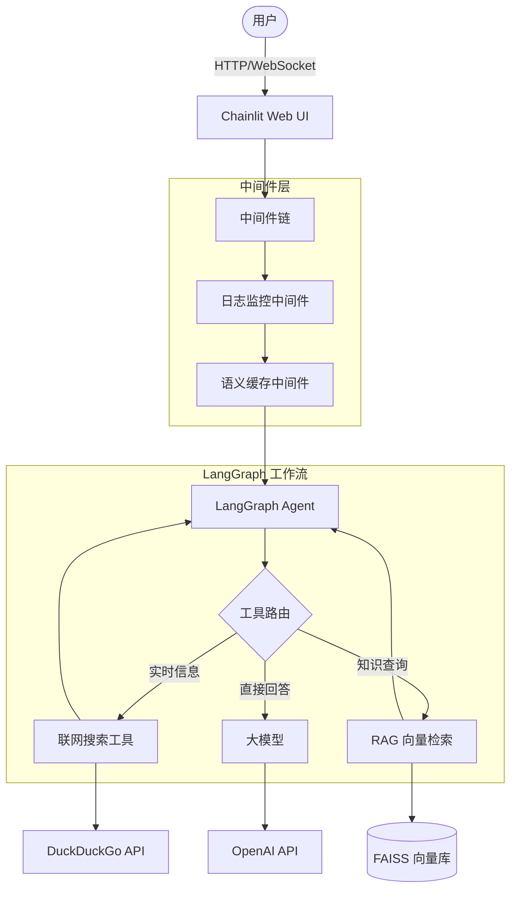

# 🤖 wzAgent - OmniAgent 工程化智能体系统

一个基于 **LangGraph** + **LangChain** 构建的生产级 AI Agent 系统，支持工具调用、RAG 知识检索、语义缓存和完整的可观测性监控。

---

## 📋 项目概述

wzAgent 是一个模块化的智能体系统，采用分层架构设计，实现了：

- **智能路由分发**：根据用户意图自动选择工具（联网搜索 / 向量检索）
- **RAG 知识增强**：基于 FAISS 向量数据库的文档检索
- **语义缓存层**：基于向量相似度的智能缓存，降本增效
- **可观测性监控**：完整的请求追踪、耗时分析和日志记录
- **容器化部署**：Docker + Docker Compose 一键部署

---

## 🏗️ 系统架构



---

## 📁 目录结构

```
wzAgent/
├── app/                          # 应用主代码
│   ├── agent/                    # LangGraph Agent 核心
│   │   ├── __init__.py
│   │   └── graph.py              # 状态图定义和工作流编排
│   ├── core/                     # 核心配置
│   │   ├── __init__.py
│   │   └── config.py             # 环境变量和配置管理
│   ├── middleware/               # 中间件层
│   │   ├── __init__.py
│   │   ├── logger_middleware.py  # 可观测性监控中间件
│   │   ├── semantic_cache.py     # 向量语义缓存中间件
│   │   └── cache_middleware.py   # 简单内存缓存中间件
│   ├── tools/                    # 工具集
│   │   ├── __init__.py
│   │   ├── search_tool.py        # DuckDuckGo 联网搜索
│   │   └── rag_tool.py           # FAISS 向量检索工具
│   └── ui/                       # 用户界面
│       ├── __init__.py
│       └── app_chainlit.py       # Chainlit Web 应用
├── data/                         # 数据存储
│   ├── docs/                     # 文档上传目录（RAG 知识库）
│   └── vector_store/             # FAISS 向量存储
├── .env                          # 环境变量配置
├── docker-compose.yml            # Docker Compose 配置
├── Dockerfile                    # Docker 镜像构建
├── requirements.txt              # Python 依赖
└── README.md                     # 项目说明文档
```

---

## 📖 文件功能详解

### 核心模块

| 文件 | 功能描述 | 关键技术 |
|------|---------|---------|
| [`app/agent/graph.py`](app/agent/graph.py) | LangGraph 工作流定义，实现 ReAct 循环 | StateGraph, ToolNode, ChatOpenAI |
| [`app/core/config.py`](app/core/config.py) | 配置管理，从环境变量加载 API 密钥等 | python-dotenv |
| [`app/ui/app_chainlit.py`](app/ui/app_chainlit.py) | Web 聊天界面，处理用户会话和消息 | Chainlit |

### 工具模块

| 文件 | 功能描述 | 关键技术 |
|------|---------|---------|
| [`app/tools/search_tool.py`](app/tools/search_tool.py) | 联网搜索工具，获取实时信息 | DuckDuckGoSearchRun |
| [`app/tools/rag_tool.py`](app/tools/rag_tool.py) | 向量检索工具，查询知识库 | FAISS, HuggingFaceEmbeddings |

### 中间件模块

| 文件 | 功能描述 | 关键技术 |
|------|---------|---------|
| [`app/middleware/logger_middleware.py`](app/middleware/logger_middleware.py) | 请求监控、耗时分析、异常捕获 | logging, uuid, time |
| [`app/middleware/semantic_cache.py`](app/middleware/semantic_cache.py) | 基于向量相似度的智能缓存 | FAISS, all-MiniLM-L6-v2 |
| [`app/middleware/cache_middleware.py`](app/middleware/cache_middleware.py) | 简单内存缓存（精确匹配） | dict |

### 部署配置

| 文件 | 功能描述 |
|------|---------|
| [`Dockerfile`](Dockerfile) | Python 3.10 容器镜像，使用清华 PyPI 源加速 |
| [`docker-compose.yml`](docker-compose.yml) | 容器编排，端口映射 8000，支持热更新 |
| [`requirements.txt`](requirements.txt) | Python 依赖清单 |

---

## 🚀 快速开始

### 1. 环境准备

确保已安装：
- Python 3.10+
- Docker & Docker Compose（可选，用于容器化部署）

### 2. 本地开发部署

```bash
# 克隆项目
cd legacy/wzagent

# 创建虚拟环境
python -m venv venv
source venv/bin/activate  # Windows: venv\Scripts\activate

# 安装依赖
pip install -r requirements.txt

# 配置环境变量
cp .env.example .env  # 或手动编辑 .env 文件
# 编辑 .env，填入你的 API_KEY
```

### 3. 配置环境变量

编辑 `.env` 文件：

```env
OPENAI_API_KEY="your_api_key"
OPENAI_API_BASE="https://api.deepseek.com/v1"  # 或其他兼容 OpenAI 的 API
MODEL_NAME="deepseek-chat"
```

### 4. 启动应用

```bash
# 方式一：直接启动
chainlit run app/ui/app_chainlit.py

# 方式二：指定端口和主机
chainlit run app/ui/app_chainlit.py -h 0.0.0.0 -p 8000
```

访问 http://localhost:8000 开始使用。

### 5. Docker 部署

```bash
# 构建并启动
docker-compose up -d

# 查看日志
docker-compose logs -f

# 停止
docker-compose down
```

---

## 📚 使用指南

### RAG 知识库使用

1. **准备文档**：将 `.txt` 或 `.md` 文件放入 `data/docs/` 目录
2. **自动加载**：系统启动时会自动加载文档到向量库
3. **查询知识**：在聊天中询问文档相关内容，Agent 会自动调用 RAG 工具

示例：
```
用户：请总结一下上传的产品手册的主要内容
Agent：【调用 vector_search_tool】根据文档片段，产品手册主要包含...
```

### 联网搜索使用

当询问实时信息时，Agent 会自动调用搜索工具：

```
用户：今天的天气怎么样？
Agent：【调用 web_search_tool】正在搜索... 根据最新信息...
```

### 语义缓存

系统会自动缓存相似问题的回答：

```
用户：什么是 LangGraph？
系统：💾 [Cache Write] 新对话已向量化并写入缓存池

用户：能解释一下 LangGraph 是什么吗？
系统：🎯 [Cache Hit] 命中语义缓存！
```

---

## ⚙️ 配置说明

### 中间件配置

在 [`app/core/config.py`](app/core/config.py) 中可调整：

```python
CACHE_THRESHOLD = 0.15  # 语义缓存相似度阈值（越小越严格）
```

### 向量模型配置

在 [`app/middleware/semantic_cache.py`](app/middleware/semantic_cache.py) 和 [`app/tools/rag_tool.py`](app/tools/rag_tool.py) 中：

```python
embeddings = HuggingFaceEmbeddings(model_name="all-MiniLM-L6-v2")
```

可更换为其他 HuggingFace 模型。

---

## 🔧 开发指南

### 添加新工具

1. 在 `app/tools/` 下创建新工具文件
2. 使用 `@tool` 装饰器定义工具函数
3. 在 `app/agent/graph.py` 中注册工具

示例：
```python
from langchain_core.tools import tool

@tool
def my_custom_tool(query: str) -> str:
    """工具描述，LLM 会根据此描述决定何时调用"""
    return "工具执行结果"
```

### 添加新中间件

1. 在 `app/middleware/` 下创建中间件文件
2. 使用装饰器模式包装函数
3. 在 `app/ui/app_chainlit.py` 中挂载

---

## 📊 监控与日志

系统提供完整的可观测性：

```
2024-01-01 12:00:00 | INFO     | [OmniAgent.Middleware] | [Trace: a1b2c3d4] ➡️ 接收到用户请求...
2024-01-01 12:00:01 | INFO     | [OmniAgent.SemanticCache] | ⏭️ [Cache Miss] 缓存未命中...
2024-01-01 12:00:03 | INFO     | [OmniAgent.Middleware] | [Trace: a1b2c3d4] ⬅️ 请求处理成功. 总耗时: 3.25s
```

---

## 🐛 常见问题

### 1. 模型下载问题

首次运行时会自动下载 `all-MiniLM-L6-v2` 模型，可能需要代理：

```bash
export HF_ENDPOINT=https://hf-mirror.com  # 使用镜像站
```

### 2. FAISS 安装问题

Windows 用户如遇 FAISS 安装失败：

```bash
conda install -c conda-forge faiss-cpu
```

### 3. 向量存储加载问题

如遇序列化错误，检查 `data/vector_store/` 目录权限，或删除后重新生成。

---

## 📝 更新日志

### v1.0.0 (2024-02-24)

- ✅ 实现基于 LangGraph 的 Agent 工作流
- ✅ 集成 DuckDuckGo 联网搜索
- ✅ 实现 FAISS 向量检索（RAG）
- ✅ 添加语义缓存中间件
- ✅ 添加可观测性监控中间件
- ✅ 支持 Docker 容器化部署

---

## 🤝 贡献指南

欢迎提交 Issue 和 PR！

---

## 📄 许可证

MIT License

---

## 🙏 致谢

- [LangChain](https://github.com/langchain-ai/langchain)
- [LangGraph](https://github.com/langchain-ai/langgraph)
- [Chainlit](https://github.com/Chainlit/chainlit)
- [FAISS](https://github.com/facebookresearch/faiss)
