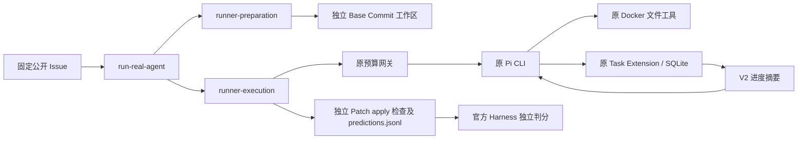

# SWE-bench Verified 与 Task V2 设计

当前准入适配基于 pi-agent / `0ba05f6418780dcb4e9cb3e696536c42cd8ae6ae`。该基线三项 CI 已通过；本轮适配源码尚未提交，不能引用基线 CI 作为新源码验收。

## 实际调用关系

SWE 通过原四阶段 Runner 扩展分支接入。固定 Issue 清单只含公开问题、repo、base_commit、角色与问题散列，不保存按题目定制的修复文件白名单。工作区从可信本地公开镜像读取一个浅提交，Git 元数据放在模型挂载之外。拒绝符号链接、子模块、Windows 路径别名、`.pi` 配置和超大仓库。问题仅进入普通用户消息。Agent 不接收 Gold、test_patch、评分结果或评测器数据。

Patch 导出拒绝空补丁、未跟踪文件、暂存区变更、HEAD 漂移、路径越界、不满足共用源码规则的文件、权限变化、二进制和密钥形态。由独立索引的 `git apply --cached --check` 确认适用后写出官方三个字段。SWE 分支不会调用合成任务验证器，更不会在宿主导入仓库 Python。仅官方结果可置 resolved。

## 固定上游与机制来源

- SWE-bench 官方发布版 v4.1.0，Commit `726c5461e2ef52d83cf1ea2107870a8bb3328d57`，MIT。核对 `swebench/harness/run_evaluation.py`、`grading.py`、`reporting.py`。本版支持 `python -m swebench.harness.run_evaluation` 的 dataset_name、split、instance_ids、predictions_path、max_workers、timeout 和 run_id。聚合结果位于工作目录的 `<model_name>.<run_id>.json`，Gold 使用 `gold.<run_id>.json`。本项目解析 resolved_ids、unresolved_ids、error_ids，不自行评分。先前选定的 5.x Commit 要求 image/eval_script 等新字段，与本轮固定数据不兼容；实际探测得到 KeyError: image，已保留证据并固定到兼容发布版。[固定源码](https://github.com/SWE-bench/SWE-bench/tree/726c5461e2ef52d83cf1ea2107870a8bb3328d57/swebench/harness)
- LangChain JS `a7c960fd1a1fa3d32717965311168667980e77a3`，MIT。`libs/langchain/src/agents/middleware/todoListMiddleware.ts` 的 write_todos 维护 pending/in_progress/completed，提示简单任务可跳过，并拒绝同一回复并行替换计划。本轮借鉴可选规划和每回复一次更新，复用本地 DAG/CAS，不复制其中的系统提示或运行时。[固定源码](https://github.com/langchain-ai/langchainjs/blob/a7c960fd1a1fa3d32717965311168667980e77a3/libs/langchain/src/agents/middleware/todoListMiddleware.ts)
- Microsoft Agent Framework `924a6e50ec0336f3c965ee8b1151c54085888b6e`，MIT。`python/packages/orchestrations/agent_framework_orchestrations/_magentic.py` 分开 Task/Progress Ledger，按循环与进展信号重规划，并限制轮数。官方实现会调用模型判断进度。本轮自行设计为确定性工具证据判断，不调用裁判模型。[固定源码](https://github.com/microsoft/agent-framework/blob/924a6e50ec0336f3c965ee8b1151c54085888b6e/python/packages/orchestrations/agent_framework_orchestrations/_magentic.py) · [官方机制说明](https://microsoft.github.io/autogen/stable/user-guide/agentchat-user-guide/magentic-one.html)

固定源码与许可证保存在 `.artifacts/swebench-task-v2/upstream/`。本轮没有引入 LangGraph、AutoGen 或 Deep Agents 运行时。

## Task V2 的实现边界

原有能力包括 SQLite DAG、任务和步骤状态机、revision CAS、执行 attempt、证据等级、Checkpoint 和未知写入恢复。新增 `v2.ts` 负责受控计划维护及进度摘要，继续使用这些表和语义，没有 schema 迁移。

全局 agentDir/pi-enhanced.json 可配置 `modules.task-manager`。原 enabled 配置仍对应 v1。显式 `mode: off` 禁用，`mode: v1` 保持旧行为，只有宿主全局的 `mode: v2, modelPlanTool: true` 才批准 V2 模型写计划。受信任项目可收紧或禁用，不能单独授予 V2 权限。关闭或未信任时不创建 Task 存储，不提供可执行的 V2 工具。

V2 工具 enhanced_task_plan_update 的外层参数为 change，支持 create、advance、replan。create 自动绑定第一个无依赖步骤以观察真实工具。advance 依赖原状态机。模型自述完成先进入 verifying，并只增加 model_claim；真正 completed 仍需原验证器或用户证据。replan 只追加恢复步骤，保留执行历史，并将新就绪步骤设为观察目标。不会自动重放工具。

更新绑定 project、session、当前活动分支上的权威 assistant entry 和 toolCallId。同一 assistant 回复出现多个计划调用会全部拒绝。事件中的一次性来源标识及 CAS 在同一 SQLite 事务内提交，防止并发覆盖与重启后重复消费。每计划最多 12 步，每会话最多 32 次模型计划更新，输入最多 8 KiB，返回最多 12,000 字符。

进度摘要恢复自已有 attempt、v2_create/v2_advance/v2_replan 事件和 Checkpoint。三次相同、可靠完成的只读操作或相同失败可请求重新规划；未结束/结果未知的写入直接报告 blocked。最多接受两次重规划，达到上限需用户处理。摘要只含工具身份、散列、状态和有界计数，不含原始输出。通过受限普通上下文送到下一正常回合，不改系统权限，也不增加独立模型请求。额外 Token 的因果归属无法从现有 Usage 分离，记为 null。

Sandbox 新增一个默认关闭的宿主能力，仅允许 enhanced_task_plan_update 进入 Task Extension。它不会发送文件操作到宿主。原六项文件工具、P1、网关预算和 Broker 仍生效。

## 固定子集与未来对照协议

数据固定为 princeton-nlp/SWE-bench_Verified / test，revision `c104f840cc67f8b6eec6f759ebc8b2693d585d4a`。原始 Parquet SHA-256 为 `a45b1fe4e2f0c8390b2b2938ac83e92ed5979000856808f3679c07812e9e6dcd`。

Gold 环境实例为 astropy__astropy-12907。候选为 astropy__astropy-13033（TimeSeries 必需列检查）、astropy__astropy-13453（HTML 表格格式）、astropy__astropy-14365（QDP 命令大小写）。选择来自公开 Issue，覆盖单文件与接口依赖，复用同一项目环境，先固定后执行；不依据 Agent 结果或 Gold 修改题目。Base Commit 和公开问题散列见 swebench-verified.json。

未来 OFF/V1/V2 使用相同实例、模型版本、Prompt、Base Commit、资源、文件工具和总预算。OFF 不暴露 Task 工具，V1 只有只读查询，V2 增加受限计划写工具；这属于明确的 treatment 差异。每次首轮记录实际 Prompt、系统提示和 tool schema 散列，不能宣称三组 schema 相同。resolved、有效补丁、正常结束、审计、请求/Token/费用、文件工具、计划更新、重复操作和 replan 分开记录。

官方环境先要求本机 Linux/x86_64 Docker、至少 8 CPU、16 GB Docker 内存和 Docker 数据盘 120 GB 可用空间。只允许 1 worker 和 1 个 Gold 实例。每个评测分配独占目录及包含补丁散列与随机值的新 run_id，以隔离 Harness 缓存。Windows 资源检查从 Docker Desktop 的 CustomWslDistroDir 定位实际 VHD；显式配置磁盘缺失时拒绝回退到旧盘。迁移至 F 盘后资源闸门通过，Gold 实际结果见验收报告。

官方 v4.1.0 导入链依赖 resource，Windows Python 导入失败。本机 Gold 探测在独立 Linux/amd64 评测容器内直接运行同一官方 CLI，参数由现有 harnessCommand 生成，未创建第二套 Agent Runner 或评分器。容器只挂载只读官方代码、单实例 evaluator 数据输出目录与 Docker socket；没有 Agent 工作区、宿主 .env 或 Provider 配置。该容器是可信评测控制进程，具有本地 Docker 控制权限，不能用于执行模型工具。Agent 工具容器的无网络、只读根和临时项目挂载维持原配置。评测入口设置 PYTHON_DOTENV_DISABLED=1，关闭官方依赖自动加载 .env。下一轮真实模型还必须先通过新提交的三平台 CI 并另获费用授权。

## 最终评测范围与信任边界

实例级 allowedPaths 已移除。所有实例共用 tracked-source 安全规则，保留源码扩展名、禁止测试/元数据/凭据路径、禁止未跟踪文件、删除/重命名/权限变化/二进制和超大补丁等限制。协议标识为 swebench_verified_source_restricted_v1。这是受限源码 Pilot，不能直接当作标准完整 SWE-bench 条件下的成绩。原路径列表没有可审计的生成记录，其答案独立性为 unknown；历史原件不修改。

Gold 控制容器的直接环境和挂载不含 Provider 密钥、宿主 .env 或 Agent 私有数据，但共享 Docker socket 赋予广泛 daemon 权限，不能宣称完全隔离宿主数据。更强边界需专用、无凭据的评测宿主或 daemon。原第三方导入是否加载凭据仍保留 unknown。

当前 SWE 真实执行通过原 run-controlled → run-real-agent 四阶段链路，使用 swe-task-v1 配置。复用 task-pair-authorization.ts，在原授权记录中增加三个模式的 modeInputs；旧两格授权的配置与校验规则保持。固定 13033、问题与 Base SHA、模式顺序、模型、预算、镜像和工具配置，授权绑定源码 Commit、CI Run、批次/输出身份及不超过 24 小时的有效期。宿主独占输出位于检出目录之外，整批与每格均以 wx 消费标记防止重试；后续格必须等前一格完成安全检查。

首次上游转发前校验逐模式完整请求指纹，且每次请求检查授权有效期。只规范化系统消息中的临时项目根路径；用户问题和工具定义不做改写。三种完整 Task schema 是实验变量，不能要求整体指纹相同；共同 Issue、Base、Tree、系统提示和基础文件工具必须相同。Stub 校准取得的逐模式指纹需要在真实执行宿主与干净的新 Commit 上重新生成并核对，不能直接沿用本工作树的临时证据。

SWE 不写历史 P5 报告。每格独占 run/task 目录保存有界脱敏 Agent JSONL、stderr、Gateway、Telemetry、审计、结果、Patch 及 predictions.jsonl。异常退出也可在工作区身份及静态 Patch 安全检查通过后保留部分补丁，不能据此标记 Agent 正常结束。补丁导出发生安全异常则停止整批。模型名称分别标记 stub/real、模式和模型。官方 Harness 使用另一独占目录，要求 --agent-result，将实例和补丁 SHA 绑定到运行结果，保存原官方报告、outcome.json 及 assessment.json。resolved/unresolved 只来自官方结果；未判分为 not_run，resolved=null。基础设施异常与 unresolved 分开记录，不更改原 Agent 结果。

用户已批准本次全新 $0.09 上限：每格 12 请求、80,000 Token、$0.03、180 秒，串行 OFF→V1→V2，不重试。仍需本轮源码提交授权、新 Commit 的 Windows/Linux/Docker CI 通过，以及有效一次性宿主授权；尚未调用付费模型。
